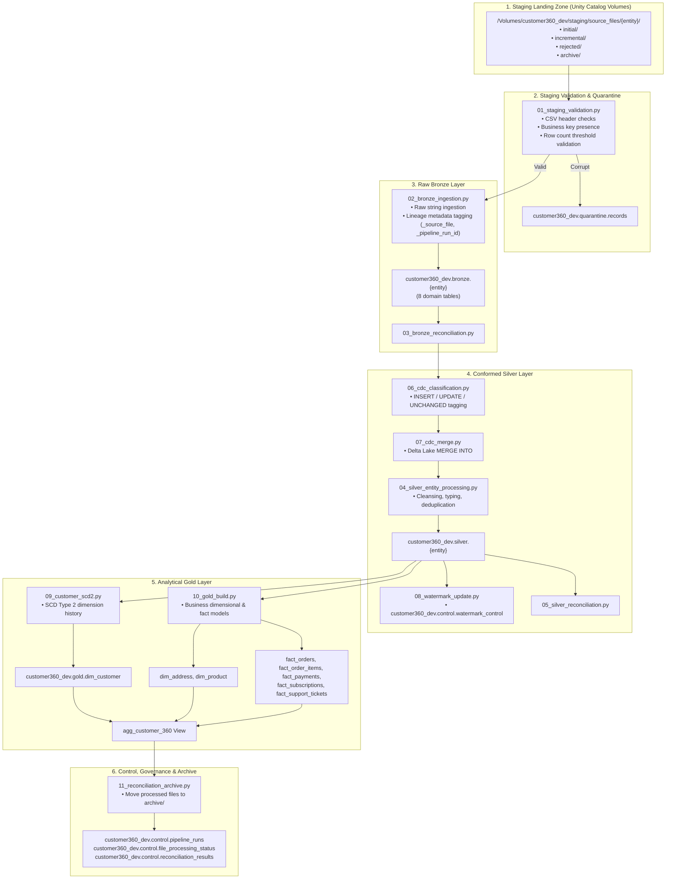

# Customer 360 CDC Platform Architecture

This document describes the architectural principles, component designs, data flow patterns, and governance models for the **Customer 360 CDC Platform**.

---

## 🏗️ 1. End-to-End Medallion Lakehouse Flow

The platform implements a multi-tier Medallion Architecture powered by **Databricks**, **Delta Lake**, and **Unity Catalog**:



---

## 🔄 2. Change Data Capture (CDC) Mechanics

The platform utilizes a state-aware CDC engine operating between Bronze and Silver layers:

1. **Watermark Scoping**:
   - Queries `customer360_dev.control.watermark_control` to fetch the highest previously processed watermark timestamp for the entity.
   - Restricts evaluation to newly arrived rows matching `PIPELINE_RUN_ID` or timestamp greater than the high watermark.

2. **Classification Logic**:
   - Incoming records are compared against the target Silver table by primary business key:
     - **`INSERT`**: Business key does not exist in Silver.
     - **`UPDATE`**: Business key exists in Silver, but one or more business attributes have changed and incoming `updated_at >= silver.updated_at`.
     - **`UNCHANGED`**: Incoming record is identical to the current Silver state. Stale or duplicate records are suppressed.

3. **Atomic Merge & Watermark Commit**:
   - Updates and inserts are merged using Delta Lake `MERGE INTO` with deterministic matching predicates.
   - Upon successful transaction commit, `08_watermark_update.py` advances the watermark in `customer360_dev.control.watermark_control`.

---

## 📜 3. Customer SCD Type 2 Architecture

Customer dimensions undergo historical versioning to maintain point-in-time analytical validity:

* **Surrogate Key**: SHA-256 hash or deterministic UUID based on `customer_id` and `effective_from`.
* **Attributes Tracked**: Status, tier, email, phone, and residency modifications.
* **Version Expiration**:
  - When an attribute change is detected on `customer_id`, the active record is expired:
    ```sql
    UPDATE customer360_dev.gold.dim_customer
    SET is_current = false, effective_to = CURRENT_TIMESTAMP()
    WHERE customer_id = :id AND is_current = true
    ```
  - A new record is inserted with:
    - `is_current = true`
    - `effective_from = CURRENT_TIMESTAMP()`
    - `effective_to = NULL`
* **Zero Leakage**: All technical ingestion columns (`_source_file`, `_pipeline_run_id`, etc.) are stripped prior to Gold emission.

---

## 🛡️ 4. Unity Catalog Governance Model

All platform assets reside within the isolated catalog `customer360_dev`:

| Schema | Purpose | Storage / Types |
| :--- | :--- | :--- |
| `staging` | Staging landing zones | Managed Unity Catalog Volume (`source_files`) |
| `bronze` | Raw append-only ingested data | Delta Lake tables with metadata columns |
| `silver` | Conformed, deduplicated business entities | Delta Lake tables with primary keys |
| `gold` | Dimensions, facts, SCD2, Customer 360 views | Delta Lake tables & analytical views |
| `control` | Pipeline run state, watermarks, audit trails | Delta Lake control tables |
| `quarantine` | Malformed, duplicate, or orphaned records | Delta Lake quarantine tables |
